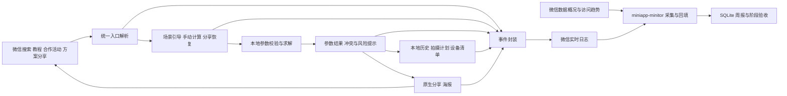

# 延时摄影计算器增长 HLD

2026-11-22 · 设计基线为小程序 v1.2.0，数据截至 2026-11-21。执行任务见 [增长开发 TODO](TODO.md)。

## 1. 目标与当前基线

最终验收要求在同一个已结算的统计日同时满足 **累计去重访客 ≥ 100,000** 和 **连续 28 个自然日平均 DAU ≥ 1,000**。验收采用微信数据，时区为 Asia/Shanghai，完整数据中的零值计入平均，缺失日期需回补后再判定。有效使用和回访指标用来解释增长质量。

| 指标 | 最新实测 | 设计影响 |
| --- | --- | --- |
| 累计用户 | 11 月 21 日微信日概况 `visit_total` 为 **1,897**。10 月 24 日为 1,850，差值 47，与后续 28 天日新增合计一致 | 暂以 1,897 作规划基线，差约 98,103。M0 用同日微信后台累计去重用户对账后锁定 |
| 平台 DAU | 10 月 25 日至 11 月 21 日共 57 个用户日，平均 **2.04**，15 天为零，峰值 20 | 先验证持续获客。前次 30 天窗口均值为 2.13，最新同长度窗口均值为 2.00 |
| 平台新增 | 同一 28 天窗口合计 47，约 **1.68 人/天**；10 月 29 日单日 20 人 | 首批渠道试验记录来源、有效使用和回访，大小渠道均按用户去重 |
| 计算 | 最新 28 天 151 条成功记录，手动 77、预设 74。预设前三为日落 27、云流动 19、星空 10 | 首屏围绕三个场景验证，继续提供手动计算。次数用于选题，人数转化需要身份和入口口径 |
| 输入与提示 | 6 条失败均为参数不足，其中 2 条空输入、3 条只填成片时长、1 条只填间隔。17 条成功记录带风险标记，缺少独立展示事件 | 优先做参数组合引导，并测量风险实际展示及处理 |
| 分享与日志 | 微信日概况分享 UV 合计为 0，结构化日志没有海报生成事件。84 个 trace 中有 58 个关联多个页面 sessionId | 实测分享接收链路。当前会话数据用于诊断页面行为，用户回访需稳定身份 |
| 数据可用性 | 28 天快照均标记完整，实时日志 206 条与快照返回总数相符。运营中心场景接口 28 天均失败，性能结果为空 | 场景归因走自有入口参数，性能通过真机和必要的业务耗时观测验证 |

数据来源为本地监控项目 `/root/miniapp-minitor/data/wechat/` 与 `data/warehouse/realtime_events.jsonl`。事件按完整 JSON 记录去除完全重复项，窗口内共 311 条，均为 v1.2.0。日志条数与接口返回总数核对只覆盖采集侧，客户端上报覆盖率通过 M0 真机验证。累计口径的微信官方文档页面本次未能打开，后台对账列入 M0 验收。

## 2. 产品路径

首批服务对象是需要自己设置拍摄间隔的摄影入门者，以及组织户外拍摄的社团和活动负责人。日落、云流动和星空教程分别带用户进入对应场景，手机用户可先核对设备是否支持设置间隔。

| 路径 | 设计 | 衡量 |
| --- | --- | --- |
| 首次使用 | 从场景卡片或手动入口输入拍摄时长、目标成片时长，以「每隔 X 秒拍一张，共 N 张」呈现结果。高级输入可展开，参考间隔和当前结果分别显示。缺参时给出可求解的组合，发生冲突时展示修改前后值并允许选择求解依据 | 首次有效使用率、录入中断点、缺参后恢复 |
| 方案传播 | 原生分享打开具体方案，接收者可照用、编辑或重算。海报显示场景、拍摄参数和入口类型。渠道教程与合作活动使用各自入口 | 接收者打开、7 日内有效使用、分享带来的新增与回访 |
| 拍摄复用 | 结果可存为本地拍摄计划，关联日期、方案和相机或手机清单，支持复制到下一次拍摄；计算历史仍可直接回填 | 计划复用人数、7/28 日回访、老用户 DAU |

将打开预设后自动展示和主动使用分成两个信号。显式手动计算成功，或对有效方案执行「使用方案」、复制结果、保存计划、开始/完成计划清单，计为有效使用。孤立的历史查看、清单浏览或分享菜单打开作为过程事件。提醒、存储估算、天气与拍摄时机由 M3 的回访和真实需求决定。当前范围聚焦拍摄方案、清单和复用。

## 3. 系统架构

### 小程序模块和数据

- **入口和会话**。在 App 前台生命周期归一化平台场景、页面路径、渠道、活动、方案和分享批次。冷启动与紧接着的首次前台回调合并为一次进入。热启动出现新外部入口时创建新会话，普通页面切换沿用会话。建议后台停留 30 分钟后再次前台时开启新会话，体验版验证后确认。页面实例和会话各有标识。
- **求解与方案**。复用现有求解器，把可计算判定、冲突方案和风险计算提供给场景、手动输入、历史回填、分享恢复。方案保存 `schemaVersion`、`sceneKey`、独立输入与必要展示快照。内部明确单位，现有拍摄时长为分钟、间隔和成片时长为秒、张数为整数。用现有舍入回归用例锁定行为，展示值按设备可设置精度提示。
- **分享契约**。首版用有长度上限的带版本原生路径传递场景、独立参数、随机分享批次及允许的来源字段。接收端重新验证字段独立性、合法范围、类型和长度，并由同一求解器重算。未知版本或非法参数回到通用计算入口并提示；热启动提示用户是否载入，防止覆盖正在编辑的数据。分享批次只关联发起与接收事件，方案快照无需服务端持久化。
- **海报与渠道码**。首版保留通用码并标明扫码打开计算器；对需线下推广的渠道先验证微信可生成并追踪的入口。仅在证明海报承接值得投入后，启用短码解析和服务端码生成，使用受限的生成入口、码与方案版本绑定、缓存、失效策略及删除清理。小程序凭证留在服务端。发布 M2 前用官方能力说明、账号后台和双真机核验路径、码参数、长度、版本及冷热启动行为。
- **计划与迁移**。每个计划保存版本、计划 ID、名称、日期、方案快照及设备事项。首次迁移从 `plannedEventChecklist` 导入一份旧计划；先完整写入并读回校验，再标记迁移完成，采用固定迁移 ID 使重试幂等。写入失败保留旧数据和当前编辑，提示重试。现有 `calculationHistory` 沿用，计划本地保存，分享仅携带拍摄参数和场景。

### 身份、事件与数据质量

- **身份**。现有采集器将原始日志 `entry.id` 读作 `openid`，结构化导出未保留该字段。最近 28 天原始结构化记录均带有该值，且有跨日报表重复值。M0 先验证官方语义、同账号跨日和跨设备一致、不同账号可区分及覆盖率。验证通过后由受限采集端生成带服务端密钥的稳定摘要，仅向分析表输出摘要。若平台标识不可用，经必要性与隐私核对后再评估轻量服务端身份，期间发布平台聚合和明确标注的会话指标，用户级业务指标标为不可用。
- **事件契约**。公共字段为事件版本、事件 ID、发生时间、应用版本、页面及会话。按事件附入口 ID、平台场景、场景键、方案或分享批次及有限枚举。原始日志载荷需测量字节上限，事件携带必要标识和枚举，渠道名称等由仓库维表补全。禁止上报清单名称和自由文本、凭证或原始用户标识。测试和正式流量按环境区分。
- **事件链**。`entry_open` → `page_view` → `preset_select` 或手动输入 → `calculate_success` / `input_validation_failed` / `calculate_failed` → `plan_effective_use`。风险记录命中、展示、处理，冲突记录选择和重算结果。传播记录 `share_intent`、可观测的取消或错误、`shared_plan_open` 和接收方的 `plan_effective_use`。计划记录保存、清单实际使用与复用。每次操作中的相关事件共享对应标识，分享发起以接收打开确认传播。
- **采集与报表**。沿用监控的日采集、近期回填、JSONL 和 SQLite。纳入日概况 `visit_total` 与访问趋势 `visit_uv`、`visit_uv_new`，旧版事件按原口径保留，新版按事件 ID 幂等导入。回填以日期和事件 ID 校验，处理缺日、重复、解析失败和标识覆盖率，发布看板注明时间窗口、分子分母及样本。平台汇总与业务事件各用自己的数据源。保存原始数据的权限与保留周期在 M0 确认，分析侧使用所需最小字段。
- **归因**。运营维护渠道、素材、活动与入口 ID 对照表。每次归一化外部进入记录本次来源，无匹配值记为 `unknown`；首次观测来源进入用户维表。首次观测和平台首次启动从 M0 起分别报告，避免存量用户回访计为渠道平台新增。接收者归因窗口内多次打开同一分享批次按人去重，同人自测和打开自己的分享从传播效果剔除。一次使用只记给最近一次仍有效且与方案匹配的分享打开记录。

## 4. 指标与增长量级

| 指标 | 计算方式 |
| --- | --- |
| 累计与平台 DAU | 以已对账的微信累计口径与每日 `visit_uv` 为准。按日展示 `visit_uv_new` 与 `visit_uv - visit_uv_new`，取连续 28 天平台 DAU 均值 |
| 首次有效使用 | 按首次观测进站用户建 cohort，统计同一自然日内首个有效使用的人数 / 到访 cohort 人数。按来源、版本和场景展示，标记身份覆盖率 |
| 有效 DAU | 每日至少一次有效使用的去重用户，单列当日首次和曾经有效使用的人数 |
| 7/28 日回访 | 按首次有效使用日建 cohort，分别统计之后第 1–7 日、第 1–28 日至少一次回访的人数 / 已成熟 cohort 人数。同步看有效回访 |
| 分享接收使用 | 以接收者与分享批次去重，从首次打开起 7 日内计有效使用，窗口成熟后计算比例。渠道汇总的人数另按用户去重 |
| 计划复用 | 按首次保存计划日建 cohort，统计之后第 1–28 日使用已保存计划或复制重拍的去重用户数 / 已成熟保存 cohort 人数 |
| 渠道投入 | 每周记录素材和活动工时、直接费用、首次观测用户、有效使用、回访和归因覆盖率。渠道付费放量前确定成本上限及停止条件 |

若以 1,897 为起点、以 365 天达累计目标进行压力测试，需要约 **269 名净新增/天**，约为当前日新增的 160 倍。若验收期仍保持约 269 新访客/天，28 天平均达到 1,000 DAU 还需约 **731 老访客/天**。

| 验收窗口日均新访客假设 | 所需日均老访客 |
| --- | --- |
| 100 | 900 |
| 269 | 731 |
| 500 | 500 |

这些值是供渠道预算和回访试验使用的算术情景。每周把近 28 天新增和老访客的实际均值，与近期 cohort 的持续回访对照。若获客改善而老用户活跃未改善，优先验证活动重复使用与拍摄计划；若有效使用改善而新增停滞，继续查找可重复获客的内容和合作渠道。

## 5. 发布与运营计划

| 阶段 | 交付和运营动作 | 出口条件 |
| --- | --- | --- |
| M0 · P0 · 数据基线 | 小程序统一入口、会话和事件；监控纳入累计、数据质量和首版漏斗 | 微信后台与快照同日对账，冷热启动与页面切换能解释进入次数，测试入口→首次使用可追踪，两账号和跨设备完成身份验证或明确指标降级 |
| M1 · P0 · 首次方案 | 首屏日落、云流动和星空，手动引导、结果、缺参与冲突处理。招募 10–20 位目标用户 | 建议试用门槛为至少 80% 参与者无需口头指引完成方案并说出间隔和张数，同时记录人数、卡点与复测结果。手动和高级参数回归通过 |
| M2 · P0 · 分享复用 | 原生分享带参数；渠道入口、海报入口提示、接收归因。以每周 3 条场景内容、3 个摄影社群或组织者为首轮试验规模 | 两台真机完成 A 分享修改过的日落方案、B 恢复并使用、日志连接两端。覆盖取消、自打开、破损链接和热启动。外部试验数据可按渠道核验 |
| M3 · P1 · 拍摄回访 | 本地多计划、历史回填、复制重拍、设备清单迁移。与合作活动复测 | 旧清单可迁移、写入失败可恢复、两份计划跨重启可复用；使用成熟的 7/28 日 cohort 判定后续投入 |
| M4 · P1 · 扩大获客 | 场景教程、搜索入口、合作方或活动模板；优先复制已产生有效使用的渠道 | 建议至少两个渠道各在连续两次投放或活动中带来可归因的有效首次使用，并记录样本、成熟回访及成本，然后决定放量 |
| M5 · P2 · 验证相邻需求 | 按拍摄计划使用与反馈试验存储估算、拍前提示或拍摄时机 | 明确目标群、反复发生的问题、验证样本与预期回访指标后立项 |

按 M0 → M1 → M2 发布 P0。M1 可提前开展访谈与原型试用，线上对比从事件对账后开始。M3 依赖 M1 的方案结构，分享计划依赖 M2。累计用户里程碑采用 **确认基线 → 10,000 → 100,000**，并行检查有效使用、接收者复用及老访客 DAU。当前基线已超过旧 TODO 的 1,000 用户里程碑，首轮试验仍用来验证获客与使用闭环。

渠道运营每周核对新增与老访客、有效使用、成熟回访、分享接收使用和成本；低样本阶段同时看分子分母与真机观察。发布内容、合作活动与渠道标识由运营维护，所用素材和入口形式按发布平台实际允许的方式执行。

## 6. 上线验收与风险

| 风险 | 验证与处理 |
| --- | --- |
| 日活与渠道归因缺口 | 采集缺日触发回填，发现字段解析失败或标识缺失时标注窗口。运营中心场景接口异常期间以自有渠道参数测量，无法归因保留 unknown |
| 计算误差、冲突或误导 | 运行 `npm test`，覆盖独立输入组合、单位、舍入、历史回填、风险和冲突选择。真机比对可执行参数与展示精度 |
| 分享入口兼容和延迟 | 体验版至少覆盖 iOS 与 Android、冷热启动、旧版本、篡改参数、无归因入口和通用码回退；计算和本地计划在弱网时可用，监控或码服务错误有独立降级路径 |
| 本地数据损坏或版本回退 | 验证旧清单迁移、两次启动、写入失败、清理缓存以及失败重试。按版本发布，优先关闭出错的分享入口或回退到通用路径；旧存储和分享版本保留兼容读取 |
| 增长集中在活动峰值 | 每周看连续 28 天均值和新老访客分量。活动按来源和批次复测，回访以成熟 cohort 解释，最终验收需同时通过累计与日活 |

发布顺序为开发回归、体验版、真机闭环、正式发布、监控回收。小程序负责入口、计算、分享与计划，监控项目负责采集、身份验证与报表，运营负责后台对账、渠道试验和每周复盘。门槛、渠道试验规模及 365 天情景为设计假设，按首轮的可归因样本校准。最终目标以微信后台与监控归档的同日数据核验。
